<p align="center">
  <a href="README.md">English</a> ·
  <a href="README.it.md">Italiano</a> ·
  <a href="README.es.md">Español</a> ·
  <a href="README.fr.md">Français</a> ·
  <a href="README.de.md">Deutsch</a> ·
  <a href="README.pt-BR.md">Português</a> ·
  <a href="README.zh-Hans.md">简体中文</a> ·
  <a href="README.ja.md">日本語</a> ·
  <b>한국어</b> ·
  <a href="README.ru.md">Русский</a>
</p>

<p align="center">
  
</p>

<p align="center">
  
  
  
  <a href="LICENSE"></a>
  <a href="https://github.com/sponsors/matteogilioli"></a>
</p>

**Porter**는 Claude Desktop의 **Code** 탭을 위한 작은 macOS 메뉴 막대 앱입니다. 한 계정이 사용 한도에 도달하면 Porter가 Claude Code 세션을 다른 계정으로 옮겨 주어, 멈춘 지점에서 같은 대화를 그대로 이어 갈 수 있습니다. 계정마다 하나씩 **여러 Claude Desktop을 나란히 실행**할 수도 있고, 세션 정리(보관, 복원, 삭제, 프로젝트 통째로 이동)도 도와줍니다.

> [!NOTE]
> 비공식 앱이며 Anthropic과 관련이 없습니다. Porter는 Claude Desktop 자체의 파일을 읽고 쓰는데, 이 파일은 문서화되어 있지 않아 업데이트 때마다 바뀔 수 있습니다. Porter는 변경하기 전에 항상 백업을 만듭니다.

## 여러 Claude Desktop을 동시에

<p align="center">
  
</p>

Claude Desktop은 보통 한 번에 계정 하나만 쓸 수 있어서, 다른 계정을 쓰려면 로그아웃했다가 다시 로그인해야 합니다. Porter가 있으면 그럴 필요가 없습니다.

- **새 프로필…**은 로그인, 설정, 세션 목록이 따로 있는 별도의 Claude Desktop을 엽니다. 거기서 다른 계정으로 로그인하면 두 창을 계속 열어 둘 수 있습니다.
- 계정 수만큼 프로필(업무용, 개인용, 고객사용 등)을 만들 수 있습니다. 모두 **동시에** 실행되며, 다른 앱처럼 Dock에 나타나고 ⌘-Tab으로 전환할 수 있습니다.
- Porter는 각 프로필의 계정, 마지막으로 기록된 사용량, 한도로 중단된 세션을 한눈에 보여 줍니다. 프로필을 열거나 맨 앞으로 가져오고, 이름을 바꾸거나 제거할 수도 있습니다.
- 프로필 간 세션 이동은 클릭 한 번이면 되고, 한 계정을 다 쓰면 다음 창에서 계속 작업하면 됩니다.
- **올바른 프로필에서 링크 열기**(옵션에 있음): 모든 프로필은 같은 Claude 앱이라서, 브라우저에서 로그인한 뒤 macOS가 열려 있는 아무 프로필로나 돌려보낼 수 있습니다. 이 옵션을 켜면 Porter가 Claude 링크를 마지막으로 사용한 프로필에 전달합니다.

Claude Desktop을 하나만 쓰고 로그아웃/로그인으로 계정을 바꾸고 싶다면 옵션에서 **여러 프로필**을 끄세요. 그러면 Porter는 앱 대신 계정을 나열하고, 이전 계정의 세션을 현재 로그인한 계정으로 옮겨 줍니다.

## 메뉴 막대 패널



메뉴 막대의 짐꾼 아이콘을 클릭하면 모든 계정을 한눈에 볼 수 있습니다.

- 계정별 **5시간 및 7일 사용량**: 여유가 있으면 초록, 한도에 가까우면 주황, 한도에 도달하면 빨강으로 표시됩니다. Claude Desktop이 얼마 전에 기록한 값은 경과 시간과 함께 흐리게 표시되고, 이미 초기화되었을 5시간 구간은 그렇다고 알려 줍니다.
- **한도로 중단된 세션**을 계정별로 세어 주고, 메뉴 막대 아이콘에도 점이 표시됩니다.
- **6개를 Personal로 이동 →**: 클릭 한 번으로 중단된 세션을 여유가 가장 많은 계정으로 옮깁니다.
- **세션 ›**을 누르면 메인 윈도우에서 해당 계정이 열립니다.

<br clear="right">

## 메인 윈도우

<p align="center">
  
</p>

모든 계정과 Claude Code 세션을 한곳에서 볼 수 있습니다.

- **프로젝트별로 묶인 세션**과 필터(열림, 한도로 중단됨, 보관됨), 프로젝트 메뉴, 검색을 제공합니다. 지금 활성 상태인 세션에는 초록 배지가 붙어, 답변 도중에 세션을 옮기는 일이 없습니다.
- 클릭으로 **선택**하고, ⇧-클릭으로 범위를 선택하거나 *모두 선택*을 쓸 수 있습니다. 하단에 동작 막대가 나타납니다.
  - **이동할 곳…**: 대상 계정을 고릅니다. 같은 세션을 두 곳에서 이어 가지 않도록 원본은 보관됩니다.
  - **복사**: 세션이 두 계정 모두에 남고, 각 사본은 자신만의 대화를 갖습니다.
  - **보관**, **복원**, **삭제**(휴지통으로 이동하므로 되돌릴 수 있습니다).
- 세션을 사이드바의 다른 계정으로 **드래그**하면 그곳으로 이동합니다.
- **프로젝트 폴더 이동**(또는 Finder에서 옮긴 뒤 다시 연결): 그 폴더를 쓰는 모든 계정의 모든 세션을 대화 및 git worktree와 함께 Porter가 갱신합니다. 폴더가 사라진 프로젝트에는 *폴더 없음*이 표시됩니다.

## 작동 방식

<p align="center">
  
</p>

Claude Code 대화는 어떤 계정에도 속하지 않는 Claude Code 자체 폴더 `~/.claude/projects`에 있습니다. 계정에 속하는 것은 Claude Desktop의 세션 **목록**뿐입니다.

```
<data folder>/claude-code-sessions/<account>/<organization>/local_<session>.json
```

(기본 데이터 폴더는 `~/Library/Application Support/Claude`입니다.) 세션을 이동하면 이 작은 파일이 다른 계정의 목록으로 복사되고, "You've hit your limit" 오류가 지워지며, 세션이 사용하는 git worktree도 함께 옮겨집니다. 실행 중인 Claude Desktop은 목록을 메모리에 들고 있으므로, Porter가 먼저 종료한 뒤 작업이 끝나면 다시 엽니다.

> [!IMPORTANT]
> Porter는 Claude Desktop이 **Mac에** 보관하는 것, 즉 **Code** 탭의 세션만 다룹니다. 채팅(Claude가 사용자의 파일을 다루는 채팅 포함)은 Anthropic 서버에 저장되며 해당 계정에 그대로 남습니다.

## 설치

**macOS 14** 이상과 [Claude Desktop](https://claude.ai/download)이 필요합니다.

**다운로드:** [최신 릴리스](../../releases/latest)에서 `Porter.dmg`를 받아 열고 **Porter for Claude Desktop**을 `Applications`로 드래그하세요. 앱이 공증되지 않아 처음에는 macOS가 차단합니다. **시스템 설정 → 개인정보 보호 및 보안**을 열고 **그래도 열기**를 클릭하거나 다음 명령을 실행하세요.

```bash
xattr -dr com.apple.quarantine "/Applications/Porter for Claude Desktop.app"
```

**소스에서 빌드**(Xcode 또는 Command Line Tools):

```bash
git clone https://github.com/matteogilioli/porter-for-claude-desktop.git
cd porter-for-claude-desktop
./scripts/build-app.sh --install
```

`dist/Porter for Claude Desktop.app`을 빌드해 `~/Applications`에 복사합니다. 옵션에서 **로그인 시 열기**를 켜 두면 Porter가 항상 대기합니다.

Porter는 English, Italiano, Español, Français, Deutsch, Português, 简体中文, 日本語, 한국어, Русский를 지원하며 Mac의 언어를 따릅니다.

## 명령줄

같은 앱으로 스크립트에서도 세션을 옮길 수 있습니다.

```bash
PORTER="/Applications/Porter for Claude Desktop.app/Contents/MacOS/Porter"
"$PORTER" --list                                        # 계정, 프로필, 세션 목록
"$PORTER" --move --from STORE --to STORE --dry-run      # 실행하면 어떻게 되는지 미리 보기
"$PORTER" --move --from STORE --to STORE --restart      # 이동(원본은 보관됨)
"$PORTER" --move --from STORE --to STORE --copy         # 이동 대신 복사
```

`STORE`는 `--list`가 출력하는 경로입니다. 특정 세션만 지정하려면 `--session local_…`(여러 번 사용 가능), 보관된 세션도 포함하려면 `--include-archived`, Porter가 아직 모르는 Claude 데이터 폴더에는 `--data-dir PATH`를 추가하세요.

Porter는 `--restart`를 줄 때만 실행 중인 Claude Desktop을 종료합니다(이후 다시 열고, 대상도 다시 시작하거나 열어 세션을 불러오게 합니다). 이 옵션이 없으면 앱을 종료해야 하는 이동은 멈추고 어떤 앱인지 알려 줍니다. `--dry-run`은 종료할 앱을 보여 줍니다.

## 알아 두세요

- **되돌리기:** 모든 변경은 `~/Library/Application Support/Porter/backups`에 백업을 만드는 것으로 시작합니다. 이동을 되돌리려면 Claude Desktop을 종료하고, 저장된 파일을 백업의 `README.txt`에 적힌 경로로 다시 복사하세요.
- **사용량 수치**는 Claude Desktop이 기록한 값이며, 계정을 사용하는 동안 간헐적으로 기록됩니다. Porter는 값이 얼마나 오래된 것인지 보여 줍니다.
- **한 번에 한 곳에서만:** 같은 세션을 두 계정에서 동시에 이어서 작업하지 마세요. 이동 시 원본을 보관하는 이유입니다. 독립된 세션 두 개가 정말 필요할 때만 복사를 사용하세요.
- 본인 소유의 계정만 사용하고, Claude 요금제의 약관을 따르세요.

## 후원

Porter는 무료 오픈 소스입니다. 기다리는 시간을 조금이라도 줄여 주었다면 [GitHub에서 후원](https://github.com/sponsors/matteogilioli)해 주세요.

## 라이선스

[MIT](LICENSE). Claude는 Anthropic, PBC의 상표입니다. Porter는 독립 프로젝트이며 Anthropic과 제휴하거나 Anthropic의 보증을 받지 않았습니다.
